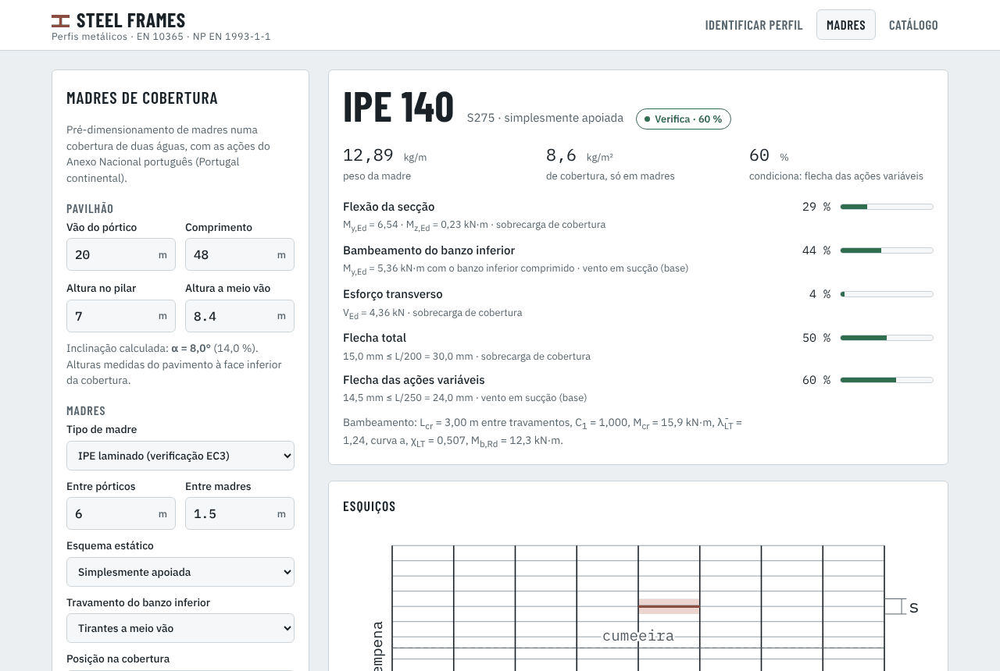
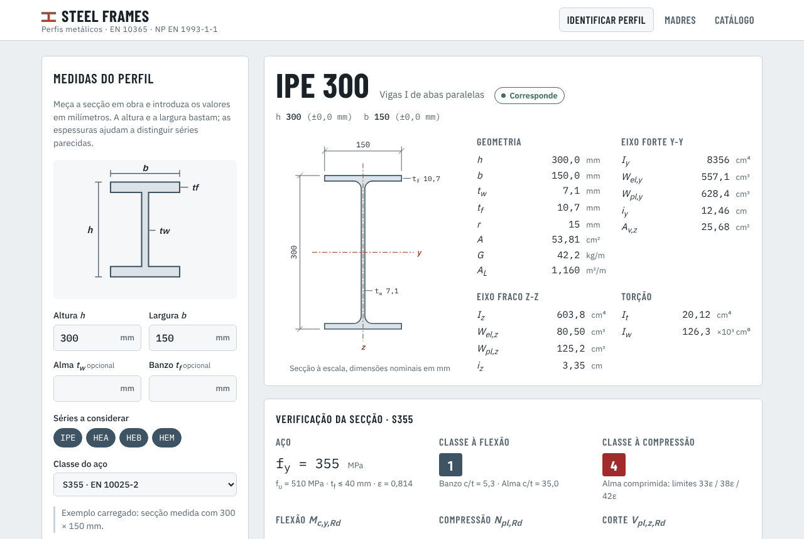
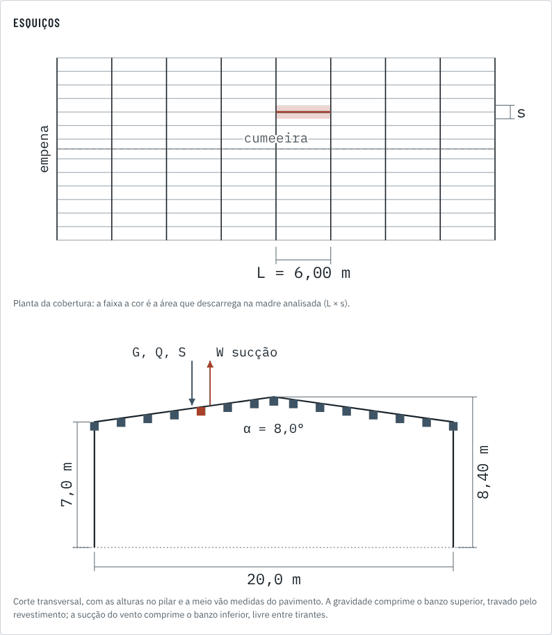
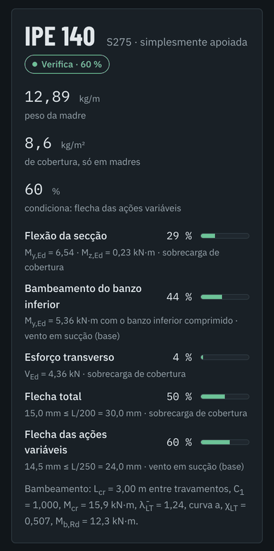

# Steel Frames

Aplicação web para **identificar perfis metálicos** e **pré-dimensionar madres de cobertura e pórticos** de pavilhões industriais, segundo os Eurocódigos com os Anexos Nacionais portugueses.

**[Abrir a app → philosadelphos.github.io/Steel_Frames](https://philosadelphos.github.io/Steel_Frames/)**

Funciona no navegador do computador e do telemóvel, sem instalação nem servidor. No telemóvel, use *Adicionar ao ecrã principal* para a ter como uma app.



## O que faz

### Identificar perfil

Escolhe-se a forma da secção e introduz-se a altura `h` e a largura `b` medidas em obra e, se quiser, as espessuras (`tw` e `tf` nos perfis I e H; `t` e o reforço `a` nos enformados). A app:

- ordena os perfis IPE, HEA, HEB e HEM, os U (UPN e UPE), ou as ómegas Superomega e as madres C e Z da O Feliz, pela proximidade às medidas e avisa quando duas secções são parecidas;
- desenha a secção à escala, com cotas e eixos y-y / z-z;
- mostra as propriedades (A, G, I, W<sub>el</sub>, W<sub>pl</sub>, i, A<sub>v,z</sub>, I<sub>t</sub>, I<sub>w</sub> e área a pintar por metro);
- classifica a secção e calcula M<sub>c,y,Rd</sub>, N<sub>pl,Rd</sub> e V<sub>pl,z,Rd</sub> para S235, S275, S355 ou S460.



### Madres de cobertura

Pré-dimensionamento de madres de uma cobertura de duas águas em Portugal continental:

- **Ações:**
  - peso do revestimento (painel sandwich, chapa, fibrocimento) e das instalações;
  - sobrecarga de cobertura (categoria H);
  - **neve** (zona pelo distrito e concelho, altitude e situações excecionais do Anexo Nacional);
  - **vento** (zonas A e B, categorias de terreno I a IV, orografia pelo Anexo A.3, coeficientes de pressão das zonas F a J, pressão interior).
- **Esquiços:** planta com a faixa de influência da madre e corte com as cargas de gravidade e de sucção.
- **Combinações:** ELU e características da NP EN 1990, incluindo a **sucção do vento**, que comprime o banzo inferior das madres.
- **Madres IPE:** verificação completa (flexão desviada, bambeamento, esforço transverso, flechas L/200 e L/250) e escolha do perfil mais leve.
- **Madres enformadas a frio da O Feliz (Superomega®, C e Z):** verificação pela EN 1993-1-3, 10.1, com as propriedades efetivas do fabricante:
  - flexão com o banzo superior travado pelo revestimento e o banzo inferior livre (carga lateral k<sub>h</sub> q e encurvadura do banzo livre);
  - restrição do revestimento opcional (C<sub>D</sub>), corte e, no Superomega apoiado pelas abas, reação no apoio;
  - continuidade nos apoios: madre contínua ou sobreposição (empalme), com o comprimento medido como dado opcional.
- **Painel de revestimento:** escolhido o painel sandwich (Topcover® 3, 5, Cap e Tile da O Feliz; painéis de 3 e 5 ondas do Panel Sandwich Group, indicativos; ou outro, com as cargas admissíveis introduzidas), a app compara o espaçamento entre madres e as ações características com a tabela do fabricante, na zona corrente e nas bordaduras, e avisa quando não cumpre, com o espaçamento máximo e a espessura mínima.

<p align="center"> </p>

### Pórtico de duas águas

Pórtico interior com bases encastradas, sem pontes rolantes, com a geometria, o local e as cargas do separador Madres:

- **Ações:** pesos próprios, revestimento, madres e instalações; sobrecarga em todas as águas ou numa só; neve nos casos (i), (ii) e (iii) da Figura 5.3; vento a 0° e a 90° com as zonas das paredes (Quadro 7.1) e da cobertura (Quadros 7.2 e 7.4) que a faixa do pórtico atravessa.
- **Análise:** elástica no plano, com imperfeições globais, α<sub>cr</sub> e amplificação dos efeitos com deslocamento lateral (NP EN 1993-1-1, 5.2 e 5.3).
- **Verificações:** secções (6.2) e encurvadura com bambeamento de pilares e travessa (6.3.3, método 2), com travamentos fora do plano a escolher; deslocamento do beirado h/150 e flechas na cumeeira.
- **Resultados:** par pilar/travessa mais leve que verifica, envolvente dos momentos, reações nas bases por ação e hipóteses.

### Catálogo

Tabelas completas das séries IPE, HEA, HEB, HEM, UPN e UPE (calculadas a partir das dimensões da EN 10365) e das madres Superomega, C e Z da O Feliz (valores do fabricante).

### Manual

Separador com o manual de utilização: como se faz o pré-dimensionamento (neve, vento, combinações, madres, painel e pórtico), com esquemas, e os cuidados a ter na escolha de cada dado (alturas, categoria de terreno, aberturas e c<sub>pi</sub>, orografia, continuidade, tirantes, escoras).

## Normas e fontes

| Tema | Referência |
| --- | --- |
| Dimensões dos perfis | EN 10365:2017 (UPN e UPE como publicados pelo fornecedor J. Justino das Neves) |
| Classificação, resistência e bambeamento | NP EN 1993-1-1:2010 + Anexo Nacional |
| Classes de aço | EN 10025-2 / EN 10025-3 (f<sub>y</sub> e f<sub>u</sub> por escalão de espessura, NA–3.2.1(1) da NP EN 1993-1-1) · EN 10346 |
| Neve | NP EN 1991-1-3:2009 + Anexo Nacional |
| Vento | NP EN 1991-1-4:2010 + Anexo Nacional |
| Sobrecarga de cobertura | NP EN 1991-1-1:2009 + Anexo Nacional |
| Combinações de ações | NP EN 1990:2009 + Anexo Nacional |
| Torção e momento crítico | SCI P363 · NCCI SN003 |
| Madres enformadas a frio | EN 1993-1-3:2006 (valores recomendados, sem Anexo Nacional português) · catálogos e desenhos O Feliz (Superomega®, madres C e Z) |
| Painéis sandwich | Tabelas de cálculo direto O Feliz (Topcover®) · fichas técnicas Panel Sandwich Group (indicativas) |

As propriedades dos perfis laminados são calculadas a partir das dimensões nominais e coincidem com os catálogos ArcelorMittal (diferenças inferiores a 0,5 %). Os valores dos Anexos Nacionais foram conferidos com o texto das NP EN 1990, 1991-1-1, 1991-1-3, 1991-1-4 e 1993-1-1. A lista, com a cláusula de cada valor e o que ainda falta fazer, está em **[docs/pendentes.md](docs/pendentes.md)**.

## Plano

1. Identificação de perfis *(feito)*.
2. Madres de cobertura em IPE *(feito)* e em Superomega, C e Z da O Feliz *(feito)*. Orografia pelo Anexo A.3 e zona de neve pelo concelho *(feito)*. Verificação do painel de revestimento *(feito)*. A seguir: coberturas de uma água.
3. **Pórtico de duas águas** com bases encastradas *(feito)*. A seguir: cutelos, bases rotuladas, ligações e pórticos de empena.
4. Pilares de empena, madres de fachada e contraventamentos, com UPN *(perfis já no identificador)*, cantoneiras e tubos SHS/RHS/CHS.
5. Medição sobre fotografia: calibrar a escala com um objeto de dimensão conhecida e marcar os pontos do perfil.

## Como usar sem internet

Descarregue o ficheiro [`index.html`](index.html) (botão *Download raw file*) e abra-o no navegador do computador. É um ficheiro único, com tudo incluído. Sem ligação, só os tipos de letra passam a ser os do sistema. No telemóvel use o endereço da app: no iPhone, por exemplo, a pré-visualização da app Ficheiros não executa o JavaScript de um `.html` descarregado.

## Desenvolvimento

```
index.html               app num ficheiro único (gerado, não editar)
src/index.html           interface
src/manual.html          manual de utilização (embutido no index.html)
src/css/style.css        estilos (tema claro e escuro)
src/js/perfis.js         dimensões nominais dos perfis (EN 10365)
src/js/perfis-u.js       dimensões dos perfis UPN e UPE
src/js/seccao.js         propriedades e verificações do Eurocódigo 3
src/js/ofeliz.js         dados O Feliz: Superomega, C e Z (gerado)
src/js/acoes.js          neve, vento e combinações (Anexos Nacionais)
src/js/paineis.js        tabelas de cargas dos painéis sandwich (gerado)
src/js/revestimento.js   verificação do painel contra a tabela do fabricante
src/js/madres.js         verificação e escolha de madres IPE
src/js/enformados.js     madres enformadas a frio (EN 1993-1-3, 10.1)
src/js/portico.js        pórtico de duas águas: análise e verificações
src/js/vista-portico.js  interface: pórtico
src/js/app.js            interface: identificação e catálogo
src/js/vista-madres.js   interface: madres de cobertura
ferramentas/construir.js gera index.html a partir de src/
ferramentas/dados_ofeliz.py gera src/js/ofeliz.js a partir dos ficheiros do fabricante
ferramentas/dados_paineis.py gera src/js/paineis.js a partir dos catálogos de painéis
testes/verificar.js      propriedades contra valores de catálogo
testes/madres.js         ações e madres IPE
testes/enformados.js     madres enformadas a frio e dados O Feliz
testes/portico.js        pórtico: solver contra soluções analíticas, ações e caso de referência
testes/paineis.js        tabelas dos painéis e verificação do revestimento
docs/pendentes.md        valores a conferir com as normas e próximos passos
```

O código edita-se em `src/`, e durante o desenvolvimento pode abrir-se `src/index.html` diretamente. Depois de cada alteração:

```
node ferramentas/construir.js
node testes/verificar.js
node testes/madres.js
node testes/enformados.js
node testes/portico.js
node testes/paineis.js
```

O GitHub Actions corre as mesmas verificações em cada Pull Request e falha se `index.html` não tiver sido gerado de novo.

## Aviso

Ferramenta de apoio ao estudo e ao pré-dimensionamento. Não substitui o projeto de estruturas elaborado e assinado por técnico habilitado.
